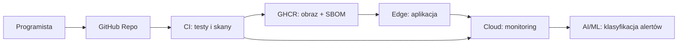

# M1 – Karta projektu (temat nr 04)

**Status:** wersja robocza do zatwierdzenia przez zespół i prowadzącego.  
**Przedmiot:** Projekt Zespołowy: Bezpieczna Infrastruktura Hybrydowa z AI (WSTI, 2026/2027).  
**Spotkanie M1:** 16.10.2026, 19:15–20:45.  
**Temat:** 04. DevSecOps: bezpieczne wdrażanie aplikacji Edge–Cloud.  
**Nazwa zespołu:** [UZUPEŁNIĆ].  
**Repozytorium GitHub:** [UZUPEŁNIĆ URL].

> **Uwaga organizacyjna:** dokumenty przedmiotu opisują zespoły **czteroosobowe**, natomiast projekt ten zakłada **5 osób na prośbę zespołu**. Zmianę liczebności należy zatwierdzić z prowadzącym. Nie wpisywać, że zgodę już uzyskano.

## Skład pięcioosobowego zespołu

| Nr | Imię i nazwisko | Rola proponowana | Zakres odpowiedzialności | Status |
|---|---|---|---|---|
| 1 | [OSOBA 1] | Lider projektu / Architekt | Cele, diagramy, backlog, integracja, dokumentacja, sprint reviews | Do potwierdzenia |
| 2 | [OSOBA 2] | DevOps / CI-CD | GitHub Actions, build, GHCR, release, pipeline | Do potwierdzenia |
| 3 | [OSOBA 3] | Security Engineer | STRIDE, ryzyka, IAM, SAST/SCA, security gates | Do potwierdzenia |
| 4 | [OSOBA 4] | Edge / Cloud Infrastructure Engineer | VM, segmentacja, Compose, deployment, rollback | Do potwierdzenia |
| 5 | [OSOBA 5] | AI / Monitoring Engineer | Telemetria z ≥2 źródeł, alerty, model AI/ML, ewaluacja | Do potwierdzenia |

Prowadzący proponuje cztery role. Wersja 5-osobowa rozdziela jego rolę **Cloud/DevOps** na **DevOps** i **Infrastructure**, zachowując wszystkie obowiązkowe kompetencje.

## Problem biznesowy i cel

Ręczne dostarczanie aplikacji na węzły brzegowe rodzi ryzyko wdrożenia obrazu zawierającego podatności, niespójności wersji i długiego przywracania usługi. Celem jest powtarzalny i kontrolowany proces od commitu do wdrożenia kontenera w symulowanym Edge–Cloud z kontrolami bezpieczeństwa, audytem i rollbackiem.

**Odbiorca:** zespół programistów i administratorów rozproszonych wdrożeń aplikacji (scenariusz laboratoryjny).  
**Środowisko:** lokalna wirtualizacja (propozycja: dwie VM Debian na Proxmox), GitHub Actions i GHCR; brak obowiązku komercyjnej chmury.

## Zakres minimalnego działającego prototypu (MVP)

1. Automatyczny build, testy i wdrożenie kontenerowej aplikacji.
2. SAST/SCA, skan obrazu, blokada krytycznych podatności.
3. SBOM **lub** podpis/manifest artefaktu – plan: SBOM i digest, podpis Cosign jako uzupełnienie.
4. Powtarzalny rollback, ślady audytowe, kontrolowana nieudana kompilacja lub skan.
5. Brak sekretów w repo, minimalne uprawnienia pipeline, izolacja runnera.
6. Logicznie oddzielone Edge i Cloud, ochrona transmisji, uwierzytelnianie i autoryzacja.
7. Centralna telemetria z więcej niż jednego źródła, alarm/incydent i **mierzalny** komponent AI/ML.

**Poza MVP:** Kubernetes, HA, komercyjna chmura, duży zakres IaC, autonomiczne reakcje ML.

## Przyjęte do konsultacji technologie

GitHub, GitHub Actions, GHCR, Docker/Compose, FastAPI, pytest, Semgrep, Trivy, Gitleaks, Syft, Prometheus, Grafana, Python/scikit-learn; szczegóły i zagrożenia: [architektura](../M2/02-architektura.md) i [ADR](../M2/07-decyzje-ADR.md). Te wybory są **propozycją**, nie wymogiem WSTI.

## Trzy najważniejsze ryzyka

| Ryzyko | Wstępna redukcja |
|---|---|
| Ujawnienie tokenu lub sekretu CI | Least privilege, brak sekretów w repo i niezaufanych PR, skanowanie sekretów |
| Publikacja i wdrożenie podatnego/zmodyfikowanego obrazu | SAST/SCA, Trivy, kontrola digestu i pochodzenia, bramka blokująca |
| Utrata dostępności Edge po aktualizacji | Healthcheck, last-known-good release, rollback, log audytowy |

Pełna analiza: [rejestr zagrożeń](../M2/04-model-zagrozen-STRIDE.md) i [rejestr ryzyk](../M2/05-rejestr-ryzyk.md).

## Plan źródeł danych i uproszczony przepływ

Źródła danych: (1) wyniki testów/skanów i statusy CI, (2) metryki/logi aplikacji Edge. Wyłącznie dane syntetyczne/testowe.

## Kryteria ukończenia M1

- [ ] Zatwierdzone 5 osób przez prowadzącego (odstępstwo od zasad 4-osobowych).
- [ ] Nazwa zespołu, imiona i role wpisane i uzgodnione.
- [ ] Repozytorium utworzone, URL działa.
- [ ] Problem, cel, odbiorca, MVP, technologie, ryzyka i przepływ omówione.
- [ ] Każdy członek ma ustalony wkład i pierwsze zadanie w backlogu.

**Stan M1 nie został zweryfikowany; nie oznaczać jako zaliczony bez potwierdzenia.**
