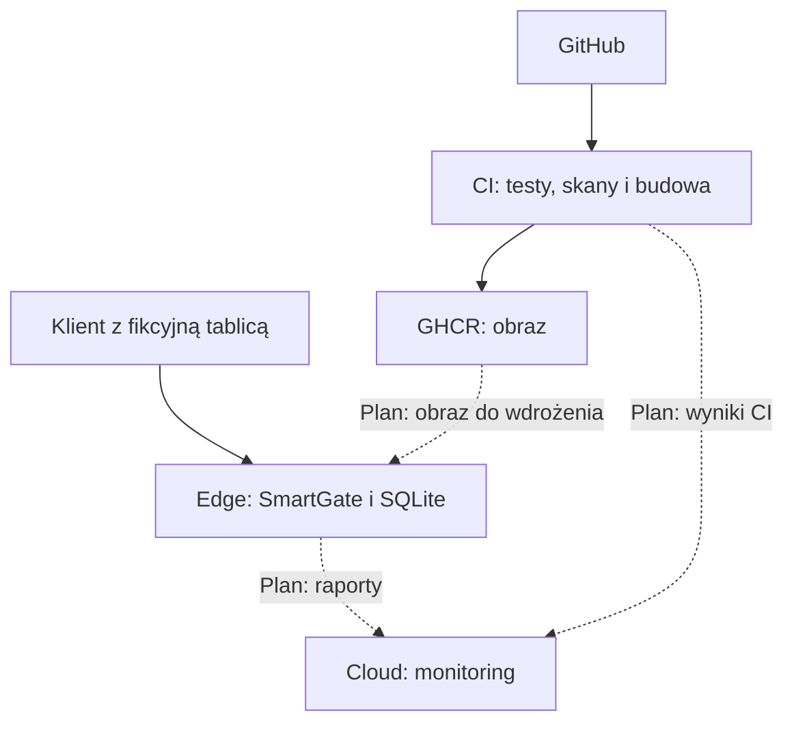

# M1 – Karta projektu SmartGate

| Pole | Ustalenie |
|---|---|
| Przedmiot | Projekt Zespołowy: Bezpieczna Infrastruktura Hybrydowa z AI, WSTI 2026/2027 |
| Temat 04 | DevSecOps: bezpieczne wdrażanie aplikacji Edge–Cloud |
| Zespół | SmartGate DevSecOps |
| Skład i role | Patryk (lider i architekt), Michał (CI/CD), Kamil (wdrożenie i sieć), Kajetan (bezpieczeństwo), Bartek (monitoring i AI) |
| Repozytorium | [SmartGate na GitHubie](https://github.com/pniewrzol/DevSecOps-Edge-Cloud-app) |

Szczegóły podziału zadań i wykonanych prac są w [dokumencie ról](02-role-i-komunikacja.md).

## Problem i cel

Gdy parking straci Internet, lokalny system nadal powinien móc sprawdzić, czy pojazd ma ważny abonament. Administrator potrzebuje też sposobu na bezpieczne dostarczenie nowej wersji programu i cofnięcie jej po awarii.

Projektujemy potok wdrożeniowy dla administratora parkingu. Aplikacja SmartGate symuluje decyzję szlabanu na podstawie fikcyjnych tablic. Dzięki temu możemy przećwiczyć wdrożenie, utratę połączenia z Cloud i przywrócenie poprzedniej wersji bez fizycznego szlabanu.

## Zakres i technologia

- **Edge** podejmuje decyzje `OPEN` i `DENY` przez API FastAPI, korzysta z SQLite i zapisuje zdarzenia.
- **GitHub Actions** testuje kod, skanuje go przez Semgrep i Trivy, buduje obraz Dockera, zapisuje SBOM i publikuje obraz w GHCR.
- **Cloud** ma odbierać zbiorcze raporty z Edge i dane z CI. Wariant podstawowy to dwie VM na Proxmoxie w osobnych sieciach za MikroTik CHR. Wariant zapasowy to lokalny Edge i Cloud na VPS. [Opis infrastruktury](../../infrastructure/README.md).
- **Docelowy prototyp** ma również wdrożyć sprawdzony obraz na Edge, sprawdzić stan aplikacji po wdrożeniu i przywrócić poprzednią wersję w razie błędu. Monitoring ma pokazać alert, a analiza AI/ML zostanie porównana z prostą regułą.

Diagram pokazuje plan projektu. Stan realizacji jest w [przeglądzie M2](../M2/01-przeglad-M2.md).

## Dane

Do testów używamy fikcyjnych tablic i abonamentów. Monitoring ma korzystać z dwóch źródeł: zagregowanych zdarzeń z Edge i wyników GitHub Actions.

## Trzy najważniejsze ryzyka

1. **Zmiana lokalnych abonamentów przez nieuprawnioną osobę.** Ograniczymy dostęp do SQLite i sprawdzimy poprawność aktualizacji danych.
2. **Podatny lub podmieniony obraz.** Wprowadzamy skany i blokadę publikacji przy krytycznym wyniku. Przy wdrożeniu sprawdzimy dokładną zawartość obrazu po digescie.
3. **Awaria aktualizacji lub sieci.** Decyzje parkingowe korzystają z lokalnej bazy. W planie są ponawianie raportów i powrót do poprzedniej wersji obrazu.

[Plan pierwszego sprintu](03-plan-pierwszego-sprintu.md) opisuje prace przed przeglądem M2.
