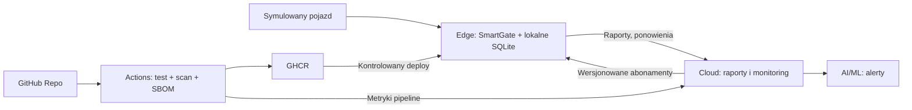

# M1 – Karta projektu: SmartGate DevSecOps

**Przedmiot:** Projekt Zespołowy: Bezpieczna Infrastruktura Hybrydowa z AI, WSTI 2026/2027.
**Temat katalogowy:** nr 04 – DevSecOps: bezpieczne wdrażanie aplikacji Edge–Cloud.
**Nazwa własna:** SmartGate DevSecOps.
**Zespół:** [NAZWA DO UZGODNIENIA].
**Repo:** https://github.com/pniewrzol/-DevSecOps-Edge-Cloud-app
**Liczebność:** 5 (według zespołu dopuszczalne maksimum; zatwierdzenie przez prowadzącego [POTWIERDZIĆ]).

## Role i odpowiedzialności

| Osoba | Rola | Odpowiedzialność |
|---|---|---|
| Patryk | Lider / architekt | architektura, backlog, DFD, decyzje ADR, integracja i przeglądy |
| Michał | Cloud / DevOps | CI/CD, GitHub Actions, skanowanie, artefakty GHCR |
| Kamil | Cloud / DevOps | Docker, Edge/Cloud VM, wdrożenia, rollback, synchronizacja |
| Kajetan | Security Engineer | STRIDE, rejestr ryzyk, security gates, uprawnienia i testy bezpieczeństwa |
| Bartek | AI / Monitoring | zbieranie telemetrii, alerty, dashboard, eksperyment ML i ewaluacja |

## Problem

Lokalna kontrola dostępu parkingowego musi podejmować decyzje także przy awarii Internetu. Jednocześnie aktualizacje oprogramowania Edge nie powinny wprowadzać podatności ani przerywać dostępności usługi. Niezabezpieczony proces dystrybucji mógłby spowodować błędne decyzje lub zmianę uprawnień.

## Cel i odbiorca

Zaprojektować oraz udokumentować **bezpieczny pipeline DevSecOps** dostarczający kontenerową aplikację SmartGate do symulowanego Edge, z centralnym Cloud monitoringowym, skanowaniem SAST/SCA/OCI, SBOM, kontrolą publikacji, rollbackiem, audytem i mierzalnym komponentem AI/ML. Odbiorcą jest administrator sieci parkingów/oddziałów (scenariusz laboratoryjny).

## MVP aplikacji SmartGate

1. Fikcyjna tablica z pliku/żądania HTTP → normalizacja i walidacja.
2. Lokalna baza SQLite abonamentów → deterministyczne `OPEN`/`DENY` (bez fizycznego sterowania).
3. Zdarzenia w lokalnej kolejce i docelowy raport do Cloud co minutę (z obsługą ponowień).
4. Praca offline oraz kontrolowana aktualizacja uprawnień po odzyskaniu łączności.
5. Oddzielne strefy Edge/Cloud, uwierzytelnione API, ochrona transmisji i logi bez sekretów.

## MVP DevSecOps (nadrzędny cel tematu nr 04)

Automatyczny build, testy, SAST/SCA/skan obrazu, blokada CRITICAL, SBOM lub podpis/manifest, bezpieczne publikowanie GHCR, wdrożenie do Edge, healthcheck, rollback, ślady audytowe. Minimalne uprawnienia i izolacja runnerów. Monitoring z dwóch źródeł oraz AI/ML porównane z baseline.

## Architektura i technologie (propozycja)

FastAPI + Python, SQLite (Edge), GitHub Actions, Docker/Compose, GHCR, Semgrep, Trivy, SBOM, Prometheus, Grafana i scikit-learn. Edge jako VM i Cloud jako druga odrębna VM na Proxmox – dopuszczona symulacja laboratoryjna.

## Trzy ryzyka kluczowe

1. Nieautoryzowana modyfikacja lokalnych abonamentów i błędne `OPEN` → autoryzacja, integralność bazy, przegląd zmian i log zdarzeń.
2. Wyciek sekretów/podatny obraz w pipeline → least privilege, skany, security gate, SBOM/digest.
3. Nieudana aktualizacja lub przerwa łączności → healthcheck, rollback, lokalne decyzje oraz trwała kolejka raportów.

## Status / kryteria M1

- [x] Temat 04, nazwa SmartGate DevSecOps, role pięciu osób i adres repo ustalone.
- [x] Problem, cel, zakres MVP i diagram wstępny opisane.
- [ ] Pełne nazwiska/nazwa zespołu, jeśli wymagane.
- [ ] Potwierdzenie przez prowadzącego dopuszczenia pięciu osób zapisane jako dowód.
- [ ] Potwierdzenie akceptacji karty M1 przez zespół/prowadzącego.

Żaden nieuzyskany podpis lub zgoda nie jest tutaj deklarowany.
