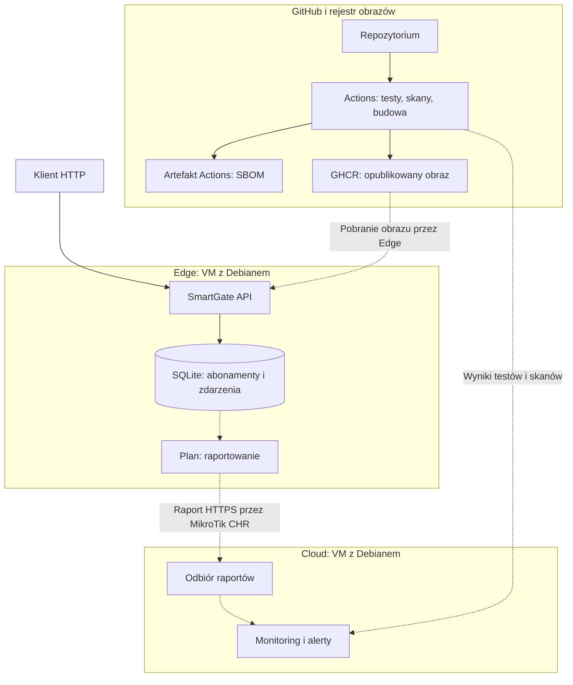

# M2 – Architektura SmartGate

W M2 sprawdziliśmy lokalne API z SQLite i potok GitHub Actions do publikacji obrazu. Przerywane strzałki na diagramie pokazują planowane połączenia. Edge i Cloud to dwie logicznie oddzielone strefy. W laboratorium mogą działać na jednym hoście Proxmox.

| Granica | Co przez nią przechodzi | Jak to ograniczamy |
|---|---|---|
| Klient → Edge | Fikcyjny numer tablicy i decyzja | Walidacja i demonstracyjny klucz API |
| Edge → Cloud | Zbiorczy raport | Plan: HTTPS, klucz odbiornika i reguła CHR na TCP 443 |
| Edge → GHCR | Pobranie obrazu | Plan: pobieranie po digescie sprawdzonego obrazu |
| CI → GHCR | Publikacja obrazu | Publikacja po kontrolach na `main`. Uprawnienie do zapisu ma zadanie publikacji. |

GitHub Actions zapisuje SBOM obrazu z zadania skanującego. Zadanie publikacji buduje obraz drugi raz. [Backlog](06-backlog.md) zawiera zmianę, która pozwoli publikować dokładnie ten obraz, który przeszedł skan.

SmartGate korzysta z lokalnych abonamentów. Aktualizacja abonamentów z Cloud jest osobnym zadaniem po uruchomieniu podstawowego raportowania. [Układ maszyn i sieci](../../infrastructure/README.md) opisuje laboratorium.
