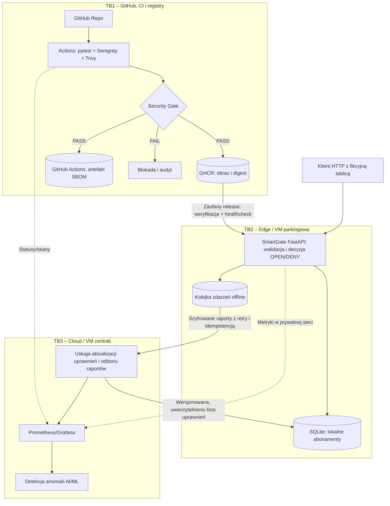

# M2-02. Architektura logiczna SmartGate DevSecOps

Na M2 działa lokalne API z SQLite oraz CI do publikacji obrazu. Diagram pokazuje również docelową usługę Cloud, synchronizację, monitoring oraz wdrożenie na Edge.

## Granice zaufania

| Granica | Przekroczenie | Kontrola |
|---|---|---|
| TB0→TB2 | symulowana tablica/żądanie do Edge | walidacja, uwierzytelnienie klienta API, ograniczenie dostępu lokalnego |
| TB1→TB2 | zatwierdzony obraz i dyspozycja deploy | minimalne uprawnienia, digest, autoryzowany kanał, healthcheck |
| TB2→TB3 | raporty/metryki | HTTPS/VPN, identyfikator zdarzenia, retry, kontrola dostępu |
| TB3→TB2 | aktualizacja abonamentów | podpis/wersja, walidacja, ochrona przed rollbackiem bazy |

## Komponenty i etap

| Komponent | Rola | Status |
|---|---|---|
| FastAPI + SQLite Edge | lokalna decyzja, syntetyczne dane, lokalne zdarzenia | potwierdzone testami i demonstracją API |
| Kontener Docker | uruchomienie Edge bez roota | obraz zbudowany i przeskanowany w CI |
| GitHub Actions, Trivy/Semgrep, GHCR | security-gated CI/CD | [przebieg #8](08-PoC-i-dowody.md) zakończony sukcesem |
| Cloud sync/reporting | raport co minutę, idempotencja, wersjonowane abonamenty | plan M3 |
| Prometheus/Grafana | telemetria z Edge + CI | plan M4 |
| AI/ML | alarmy bezpieczeństwa i anomalie | plan M4 |
| Rollback/deploy agent | ostatni poprawny digest i audyt | plan M3–M5 |

**Założenia:** tylko fikcyjne tablice; brak kamery ANPR i fizycznego szlabanu. Przy braku łączności baza Edge nadal obsługuje lokalne decyzje, raporty czekają w trwałej kolejce. Zasady wygasania nieodświeżanych abonamentów wymagają osobnego ADR.
