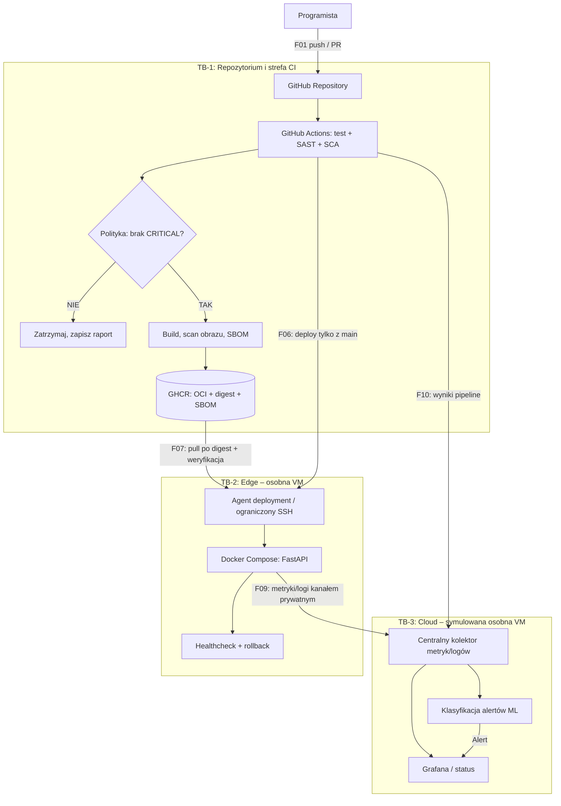

# M2-02. Architektura logiczna

**Status:** architektura proponowana, do zatwierdzenia przez zespół. Notacja zbliżona do C4 (kontenery i systemy). Deployment i monitoring przewidziane na M3–M4.

## Diagram

## Strefy i granice zaufania

| Strefa | Właściciel | Zaufanie / izolacja |
|---|---|---|
| TB-0 – stacja programisty | programista | niezaufany kod wejściowy; uwierzytelnienie repozytorium |
| TB-1 – GitHub/CI/GHCR | dostawca SaaS i zespół | workflow PR bez sekretów, minimalne permissions, osobna bramka publikacji |
| TB-2 – Edge | operator labu | VM odizolowana od CI; ograniczone konto wdrożeniowe, brak publicznego Dockera |
| TB-3 – Cloud | operator labu | odrębna VM, odbiór danych poprzez zabezpieczony kanał, RBAC w Grafana |

## Komponenty

| Komponent | Funkcja | Dane | Kontrole |
|---|---|---|---|
| GitHub | kod i PR | commity, workflow | branch protection, MFA |
| GitHub Actions | testy, skany, build | logi i wyniki skanów | hosted runner na PoC, `permissions` ograniczone, bez sekretów na PR |
| Semgrep, Trivy | SAST i SCA / skan OCI | raporty JSON/SARIF | blokada CRITICAL; jawna polityka wyjątków |
| GHCR | obrazy OCI | artefakty, SHA, SBOM | odczyt/zapis zgodnie z rolą, obrazy po digest |
| FastAPI | usługa Edge | /health, /metrics | bez roota, healthcheck |
| Agent wdrożeniowy | kontrolowana aktualizacja | manifest wersji | odseparowany klucz/poświadczenie, lista dozwolonych operacji |
| Prometheus/Grafana | telemetria | metryki, alerty | VPN/mTLS lub reverse proxy TLS + auth; ograniczone konta |
| ML | klasyfikacja alertów | wyniki skanów i historii deploymentów | walidacja danych, raport jakości |

## Decyzje otwarte

- Mechanizm wdrożenia: preferowane połączenie SSH przez tunel VPN z ograniczonym użytkownikiem; do zweryfikowania na M3.
- Czy repozytorium będzie publiczne, czy prywatne: **[DECYZJA ZESPOŁU]**.
- Czy podpis Cosign wchodzi do MVP poza SBOM: opcjonalnie, nie wymaga katalog.
- Jak rozwiązać bezpieczny scrape Prometheus: rekomendacja pull przez prywatny kanał; diagram pokazuje logiczny przepływ telemetrii.

## Przygotowanie środowisk (docelowo)

| VM | Komponenty | Oddzielenie |
|---|---|---|
| edge-01 | Docker Engine + Compose + FastAPI | osobny system, konto deploy |
| cloud-01 | Prometheus + Grafana + analizator | osobny system i segment logiczny |

Nie wystawiać portu Docker API do internetu. Bezpośredni dostęp administracyjny do Edge tylko z autoryzowanej sieci labowej.
