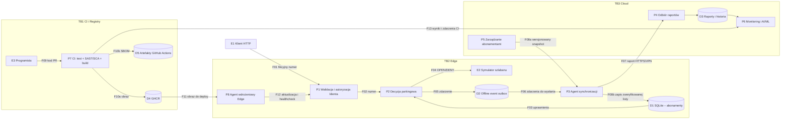

# M2-03. DFD – przepływy danych SmartGate

**Notacja:** E – encja zewnętrzna, P – proces, D – magazyn, TB – granica zaufania. Kierunki transportu są logiczne i nie oznaczają wdrożonych połączeń.

| ID | Informacja i cel | Kontrola |
|---|---|---|
| F01 | Fikcyjna tablica do Edge | walidacja formatu, ograniczenie źródeł |
| F02–F03 | tablica i lokalne abonamenty | autoryzowany dostęp, ochrona SQLite |
| F04 | decyzja OPEN/DENY do symulatora | odseparowane sterowanie (bez sprzętu) |
| F05–F06 | lokalne zdarzenia do trwałej kolejki | identyfikator i czas, brak utraty po restarcie |
| F07 | zbuforowane raporty do Cloud | TLS/VPN, retry i idempotencja |
| F08a–F08b | wersjonowana lista abonamentów do Edge | autoryzacja, integralność, kontrola wieku danych |
| F09 | PR i kod źródłowy do CI | review, brak sekretów w PR |
| F10a–F10b | obraz do GHCR i SBOM do artefaktów Actions | publikacja po przejściu bramek CI; identyfikacja obrazu przez digest |
| F11–F12 | wdrożenie Edge i healthcheck | kanał uwierzytelniony, rollback |
| F13 | wyniki pipeline do Cloud | bez sekretów, ograniczona telemetria |

**Stan M2:** F01–F05 działają lokalnie przez API i SQLite. F09 i F10a–F10b działają w GitHub Actions. Synchronizacja z Cloud, wdrożenie na Edge i eksport telemetrii pozostają w planie.
