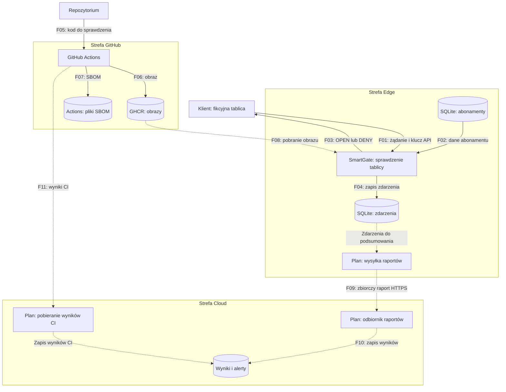

# M2 – Przepływ danych (DFD)

DFD pokazuje, jakie dane trafiają między klientem, aplikacją, magazynami i usługami. Strzałki przerywane dotyczą przyszłych prac.

| Przepływ | Dane i stan |
|---|---|
| F01–F04 | Działają lokalnie. API przyjmuje fikcyjną tablicę, sprawdza abonament, zwraca wynik i zapisuje zdarzenie. |
| F05–F07 | Działają w CI. Obraz trafia do GHCR, a SBOM do artefaktów GitHub Actions. |
| F08 | Plan M3. Edge pobiera obraz do wdrożenia. |
| F09–F10 | Plan M3. Edge wysyła liczniki i identyfikator raportu po HTTPS. Cloud zapisuje raport raz, także po ponowieniu wysyłki. |
| F11 | Plan M4. Cloud pobiera wyniki CI jako drugie źródło monitoringu. |

`GET /api/v1/events/summary` już zwraca lokalne liczniki oraz liczbę zdarzeń oczekujących. Wysyłkę raportów trzeba jeszcze wdrożyć. W raportach do Cloud wystarczą zagregowane dane. Numery rejestracyjne pozostają lokalnie.
