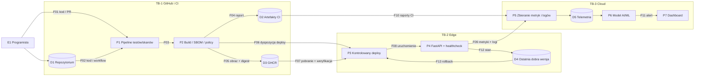

# M2-03. Diagram przepływu danych (DFD)

**Notacja:** procesy P, magazyny D, podmioty zewnętrzne E. Wzajemnie izolowane strefy TB. Jest to model logiczny, a nie konfiguracja gotowej sieci.

## Rejestr przepływów

| ID | Źródło → cel | Typ danych | Transport / wymaganie bezpieczeństwa |
|---|---|---|---|
| F01 | Programista → repo | kod, commit, PR | HTTPS/SSH, MFA, PR review |
| F02 | Repo → CI | workflow i kod | kontrola zmian, pinning akcji |
| F03 | Testy → build | status testów, skanów | bramka bezpieczeństwa; brak przejścia po błędzie |
| F04 | Build → artefakty CI | raport JSON, logi | ograniczony dostęp, retencja |
| F05 | CI → GHCR | obraz, digest, SBOM | uwierzytelniony push po przejściu skanów |
| F06 | CI → Edge | identyfikator wersji, dyspozycja | auth i least privilege; bez publicznego webhooku bez zabezpieczeń |
| F07 | GHCR → Edge | OCI po digest | TLS, weryfikacja integralności/podpisu jeśli używany |
| F08 | deploy → runtime | polecenie Docker Compose | konto techniczne z ograniczeniami |
| F09 | Edge → Cloud | /metrics, logi, healthcheck | logicznie Edge→Cloud; fizycznie pull lub forward przez VPN/TLS |
| F10 | CI → Cloud | raporty skanów, statusy deploy | auth, walidacja po stronie kolektora |
| F11 | ML → dashboard | klasa alertu, confidence | log audytowy, rozdzielone uprawnienia |
| F12 | healthcheck → stan | dobry digest, timestamp | chroniony plik/manifests |
| F13 | stan → deploy | ostatni dobry digest | jawna procedura rollback, audyt |

## Przykłady danych syntetycznych

- `build_id`, `commit_sha`, `status`, `duration_seconds`, `critical_findings`, `high_findings`, `test_failures`, `rollback_required`.
- Dane telemetrii: `service_up`, liczba żądań HTTP, błędy 5xx, czas uruchomienia kontenera.
- **Nie przekazywać** do modelu haseł, tokenów, prywatnych kluczy, payloadów zawierających dane osobowe.

## Granice i najważniejsze kontrole

1. TB-0 → TB-1: kod z PR jest niezaufany; uruchomienie build nie daje uprawnień do deploy.
2. TB-1 → TB-2: wdrożenie tylko zatwierdzonych artefaktów, przez kanał uwierzytelniony.
3. TB-2 → TB-3: ograniczony eksport metryk; oddzielne poświadczenia, TLS/VPN.
4. Przekazanie danych pipeline do AI: filtracja sekretów, walidacja formatu i uprawniony odbiorca.
